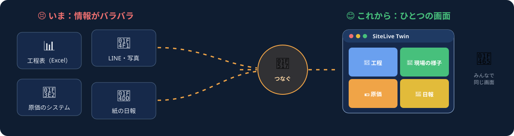
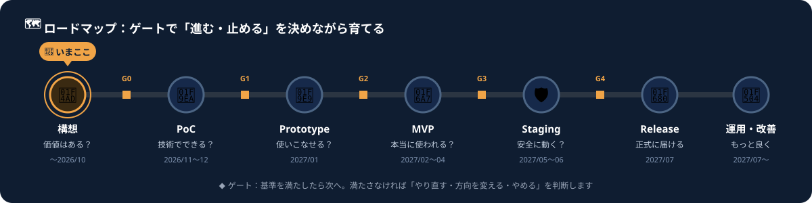
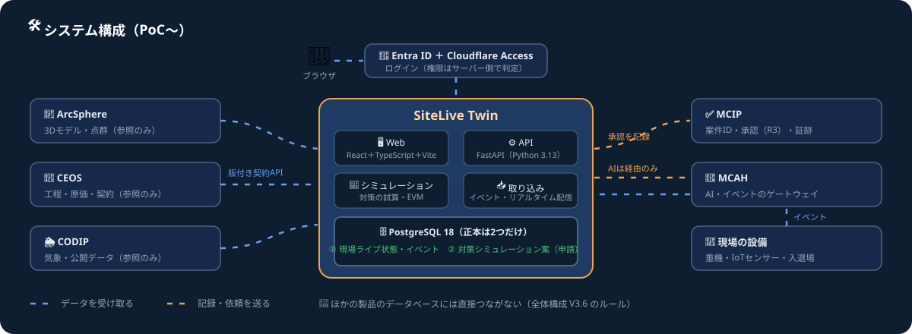
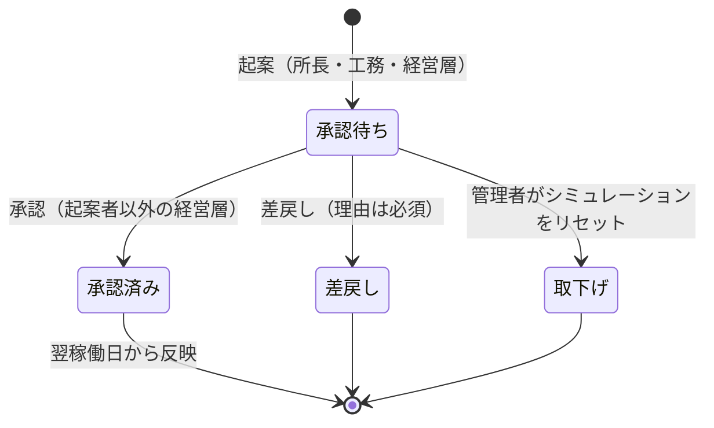

<div align="center">



-f0a447?style=for-the-badge)


**🏗️ 工事現場の「いま」を、テレビ中継のように見て、すぐに手を打つための仕組みです。**

</div>

---

## 🧭 このページの読み方

あなたに近いところから読んでください。どこから読んでもわかるように書いています。

| 読む人 | おすすめ | 読む時間 |
|---|---|---|
| 🧒 **はじめての方**（建設やITにくわしくない方） | [1. はじめての方へ](#for-everyone) | ⏱️ 3分 |
| 👷 **建設土木エンジニア**（所長・工務・施工管理） | [2. 現場で働く方へ](#for-site-engineers) | ⏱️ 5分 |
| 📊 **経営企画スタッフ** | [3. 経営企画の方へ](#for-planning) | ⏱️ 5分 |
| 🛠️ **DXエンジニア** | [4. DXエンジニアの方へ](#for-dx-engineers) | ⏱️ 8分 |

---

<a id="for-everyone"></a>
## 🧒 1. はじめての方へ

### 💬 ひとことで言うと

> **工事現場の「デジタルのふたご（ツイン）」をつくって、遠くからでも現場の様子がわかるようにするアプリです。**

ふたごの片方（本物の現場）で何かが起きると、もう片方（画面の中の現場）にもすぐ同じことが起きます。
だから、事務所や本社にいても「いま現場がどうなっているか」が、ひと目でわかります。



### 🤔 どうして必要なの？

| 😣 いまの困りごと | 😊 このアプリがあると |
|---|---|
| 📊 工程表・📱 写真・🏢 お金の記録が、べつべつの場所にある | 🖥️ **ひとつの画面**で全部見られる |
| 🐢 遅れに気づくのは、1週間後の報告のとき | ⚡ **その日のうち**に色で知らせてくれる |
| 🎲 「どうすれば間に合う？」を、勘で決めがち | 🧮 いくつかの対策を**計算で比べて**から決められる |
| 🫥 「なぜそう決めたか」が残らない | 📒 決めた理由が**記録**に残り、次の現場に生かせる |

### 🪜 使い方は5ステップ



1. 👀 **見る**　すべての現場の様子を、地図と色でひと目で見ます。
2. 💡 **気づく**　遅れている現場は、赤や黄色に光って知らせます。
3. 🔍 **原因を探す**　3Dの現場で「どこで、なにが」止まっているかを見ます。
4. ⚖️ **対策を比べる**　「トラックをふやす」「人をふやす」などを選ぶと、いつ終わるか・いくらかかるかを計算します。
5. ✅ **決める**　えらんだ対策を、えらい人（承認する人）がOKすると、次の日から現場に反映されます。

### 🎮 ためしてみよう（ネットなしで動きます）

| デモ | なにができる？ |
|---|---|
| 🎬 [オフラインデモ](prototypes/offline-demo/sitelive-offline-demo.html) | 5ステップを、早送りの現場で体験できます |
| 🖥️ [システムWebUIサンプル](prototypes/system-webui/sitelive-system-webui.html) | 本物の業務システムに近い15の画面を、役割を変えながら試せます |

> 💡 **開き方**：リンク先で「⬇️ Download raw file」を押してパソコンに保存し、ダブルクリックするとブラウザで動きます。データはすべて**練習用のつくりもの**です。

---

<a id="for-site-engineers"></a>
## 👷 2. 現場で働く方へ（建設土木エンジニア）

### 🧱 題材：擁壁を含む道路改良工事

最初の題材は「A現場：県道○○線 道路改良」です。土工 → 擁壁工 → 排水工 → 舗装工 の流れで、**擁壁工が遅れたとき**にどう気づき、どう手を打つかを試します。



### 📖 こんな場面で使います

> 🚨 **朝9時**：擁壁工が計画より **3日** 遅れていると、画面が赤く光りました。
>
> 🔍 **3Dで確認**：バックホウ（BH-01）が、ダンプを待って止まっている時間が長いことがわかりました。原因は**ダンプ不足**です。
>
> 🧮 **対策を比べる**：「🚚 ダンプを2台ふやす」＋「👷 擁壁の班を1班ふやす」で、完成予測が **12/29 → 12/1** に早まり、費用は **351万円** と出ました。
>
> ✅ **起案 → 承認**：所長が起案し、支店の承認者がOKすると、**翌稼働日から**計画に反映されます。

### 🧰 現場でできること

| 画面 | 現場でのイメージ |
|---|---|
| 🧱 **ライブツイン** | 3Dの現場で、重機・作業員・できあがった部分を色で見る（緑＝完了、赤＝遅れ、青＝これから） |
| 📅 **4D工程** | 「計画」と「実績・予測」の3Dを並べて、日付をずらしながら比べる |
| 🧮 **対策シミュレーション** | 🚚 ダンプ増車　👷 擁壁班の追加　📆 土曜稼働　🏭 プレキャスト化 の組み合わせを、すべて試算して比べる |
| 🚜 **重機・稼働** | 重機ごとの稼働率と待ち時間。待ちが長い重機がすぐわかる |
| 📝 **日報** | 重機や入退場のデータから**自動で下書き**。確認して少し書き足すだけ |
| 🦺 **安全・環境** | 暑さ指数・風速・騒音・振動。強風でクレーン作業を止めたときも記録 |
| 💴 **原価管理（EVM）** | 出来高と原価を同じグラフで見る（下の用語を参照） |

### 📚 ミニ用語集

| 用語 | ひとことで |
|---|---|
| 🏃 **SPI**（工程の進み具合） | 「予定どおり進んでいるか」の点数。**1より小さいと遅れ**。0.92なら予定の92%しか進んでいない |
| 💰 **CPI**（お金の使い方の効率） | 「予定どおりのお金でできているか」の点数。**1より小さいと使いすぎ** |
| 🔮 **EAC**（最終原価の見込み） | 「このままだと、最後にいくらかかりそうか」 |
| 🕐 **4D** | 3D（形）＋ 時間。工事が日ごとに進んでいく様子を立体で見ること |
| 🪞 **ツイン** | 本物の現場とそっくりな、画面の中の「ふたご」の現場 |

### 🙌 現場の手間をふやさない工夫

- ✍️ **入力は最小限**：日報は自動の下書きを確認するだけ。
- 🔐 **役割ごとに権限**：所長・工務は「起案」と「日報」、経営層は「承認」。
- ⚖️ **自分の起案は自分で承認できない**：起案した人とは別の人が承認します（職務分掌）。
- 🧾 **だれが・いつ・なにをしたか**を自動で記録（監査ログ）。

---

<a id="for-planning"></a>
## 📊 3. 経営企画の方へ

### 🎯 ねらい

「**遅れに早く気づき、根拠をもって早く決める**」ことで、工期の遅れと手戻りの費用を減らします。
決めた理由が記録に残るので、次の現場の計画（フロントローディング）にも生かせます。



| 指標 | いま | 目標（MVP） | はかり方 |
|---|---|---|---|
| 🔔 遅れに気づくまで | 数日（週報で知る） | **1営業日以内** | 遅れの発生から検知までの時間 |
| ⚖️ 対策を決めるまで | 次の会議まで | **3営業日以内** | 検知から承認までの時間（記録から自動計算） |
| 🚜 重機の待ち時間 | 見えていない | **見える化して10%改善** | 稼働・待機・停止の割合 |
| 📝 日報・週報づくり | 手作業で集計 | **50%へらす** | 作成時間（導入前後で比べる） |
| 👥 使われているか | — | **対象者の80%が週1回以上** | 利用記録 |
| 🗣️ 工程会議 | 資料集めに時間がかかる | **毎回この画面で話す** | 会議での利用 |

### 🗺️ 進め方：小さく試して、だめなら早めに止める



| | フェーズ | 確かめること | 時期（案） | 次へ進む条件（ゲート） |
|---|---|---|---|---|
| 💭 | **構想** 📍いまここ | 取り組む価値はある？ | 〜2026/10 | **G0** 憲章・体制・予算に合意 |
| 🧪 | **PoC** | 技術的にできる？ | 2026/11〜12 | **G1** 必須の技術検証（7項目中6項目）をクリア |
| 🧩 | **Prototype**（必要なとき） | 利用者が使いこなせる？ | 2027/01 | **G2** 作業の完了率80%以上・使いやすさ評価70点以上 |
| 🚧 | **MVP** | 1つの現場で本当に使われる？ | 2027/02〜04 | **G3** 上の効果のうち4つ以上を達成 |
| 🛡️ | **Staging** | 本番に近い条件で安全・安定？ | 2027/05〜06 | **G4** セキュリティ診断・復旧訓練をクリア |
| 🚀 | **Release** | 正式に届ける | 2027/07 | パイロット現場 → 支店 → 他支店 の順に展開 |
| 🔄 | **運用・改善** | はかる → 学ぶ → 直す → 次のリリース | 2027/07〜 | **G5** 四半期ごとに「続ける・広げる・縮める」を判断 |

> 🛑 **ゲートでは「Go」だけでなく、「条件付きGo」「やり直し」「方向転換」「中止」も選べます。** 投資を少しずつ行い、見込みがなければ早めに止められるようにしています。

### 🧩 ほかのシステムとの関係（重ならないように）

社内の「みらい建設土木DX・AI統合基盤」には、すでに3Dモデル（ArcSphere）、工程・原価（CEOS）、承認の記録（MCIP）を受け持つ製品があります。
SiteLive Twin は、それらを**つないで見せる役**に徹し、自分で持つデータは次の2つだけにします。

- 📡 **現場の「いま」の状態**（重機・作業員・センサーをまとめたもの）
- 🧮 **対策シミュレーションの案**（起案された申請）

### 📑 判断に使う資料

| 資料 | 内容 |
|---|---|
| 📘 [企画構想案](docs/00-project/concept.html) | なにを・なぜつくるか |
| 📜 [プロジェクト憲章](docs/00-project/charter.html) | 目的・範囲・体制・予定・未決事項 |
| 🚦 [フェーズゲート定義書](docs/00-project/phase-gates.html) | ゲートごとの判定基準と、そろえる資料 |
| ⚠️ [リスク・課題管理台帳](docs/00-project/risk-register.html) | 15のリスクと対策 |

> 📝 **未決事項**：パイロット現場とデータ提供元、各役割の担当者、予算、名称の商標確認。

---

<a id="for-dx-engineers"></a>
## 🛠️ 4. DXエンジニアの方へ

### 🏛️ システム構成



| 区分 | 担当 | SiteLive Twin の扱い |
|---|---|---|
| 📡 現場ライブ状態の集約ビュー・イベント | SiteLive Twin | ✅ **正本** |
| 🧮 対策シミュレーション案（申請） | SiteLive Twin | ✅ **正本**（承認の証跡は MCIP） |
| 🧱 3Dモデル・点群 | ArcSphere | 🔗 参照のみ |
| 📅 工程・原価・契約 | CEOS | 🔗 参照のみ（版付き契約 API） |
| ✅ 案件ID・承認・証跡 | MCIP | 📝 記録（承認は R3 二者承認） |
| 🌦️ 気象 | CODIP | 🔗 参照のみ |
| 🤖 AI（日報の下書きなど） | MCAH | 🚪 経由のみ（R1。Provider の直接呼び出しは禁止） |

> 🚫 **他リポジトリの DB には直接つながない。** 連携は `contracts/` の版付き契約・API・イベントで行います（全体構成 V3.6）。

### 🧪 PoC で確かめる7つのこと

| ID | 検証 | 合格ライン |
|---|---|---|
| T1 | 🚜 重機テレマティクス・位置データの取り込み | 遅延 **5分以内** |
| T2 | 📅 CEOS の工程・原価から EVM を算出 | CEOS の値との差 **0.5%以内** |
| T3 | 🧱 ArcSphere の3D（IFC / 3D Tiles）を表示し、部材と工程を紐付け | 読み込み **10秒以内**・**30fps以上** |
| T4 | ⚡ リアルタイム配信 | 画面反映 **3秒以内**・同時 **20人** |
| T5 | 🧮 対策シミュレーション | 全16通りを **3秒以内** |
| T6 | ✅ MCIP への承認記録（R3・職務分掌） | 証跡が残る |
| T7 | 🔐 Entra ID ＋ Cloudflare Access、サーバー側の権限判定 | 権限外の操作を拒否 |

### 🧰 技術スタック（OS・アプリ選定 BP V3.5 準拠）

| 層 | 採用 |
|---|---|
| 🖥️ フロントエンド | React ＋ TypeScript ＋ Vite（Node 24 LTS） |
| ⚙️ バックエンド | FastAPI（Python 3.13、`uv.lock` 必須） |
| 🗄️ データベース | PostgreSQL 18 |
| 🐳 実行環境 | Docker Compose、Ubuntu 26.04 LTS |
| 🏗️ インフラ | OpenTofu |
| 📦 リリース | SBOM・署名・Attestation・digest 固定（`latest` タグ禁止） |

### 🔁 申請（対策の起案）の状態



### 📁 リポジトリ構成

```text
SiteLive-Twin/
├── 📚 docs/                 文書（すべて単体で開ける HTML）
│   ├── index.html           ← 入口
│   ├── 00-project/          構想・憲章・フェーズゲート・リスク
│   ├── 01-requirements/     要件定義
│   ├── 02-design/           画面・アーキテクチャ・データ連携
│   ├── adr/                 設計判断の記録（ADR）
│   ├── 10-poc/ … 60-operations/   フェーズ別の計画書とひな形
│   └── assets/readme/       この README のアニメーション SVG
├── 🎬 prototypes/           構想段階のデモ（単体 HTML）
├── 💻 src/                  アプリケーション（PoC から）
├── 📜 contracts/            版付き契約（手で編集しない）
├── 🧪 tests/                unit / contract / integration
├── 🤖 ai/                   context / evals / prompts
├── 🚢 deploy/               onprem / cloud
└── 🗃️ migrations/           自分の schema のみ
```

### ▶️ デモを動かす・作り直す

```bash
# デモはブラウザで開くだけ（サーバー不要）
start prototypes/system-webui/sitelive-system-webui.html

# システムWebUIは生成物。テンプレートを直したら作り直す
cd prototypes/system-webui
node build_webui.js ../offline-demo/sitelive-offline-demo.html webui_template.html sitelive-system-webui.html
```

### 🤝 開発のルール

- 🌿 `main` に直接 push しない：**Branch → PR → CI → レビュー → Merge**（通常2名、重要な変更は3名）
- 📝 コミットは **Conventional Commits**（`feat:` `fix:` `docs:` など）
- 🧭 技術的な判断は `docs/adr/` に ADR として残す（[ADR-0001](docs/adr/0001-repository-and-sor-scope.html)・[ADR-0002](docs/adr/0002-tech-stack.html)）
- 🔐 秘密情報（API キー・接続情報）はリポジトリに置かない（[SECURITY.md](SECURITY.md)）
- 🤖 AI エージェント向けの入口：[CLAUDE.md](CLAUDE.md)・[AGENTS.md](AGENTS.md)

<details>
<summary>📚 <b>ドキュメント一覧（20本）をひらく</b></summary>

| 番号 | 文書 | フェーズ |
|---|---|---|
| SLT-DOC-01 | [企画構想案](docs/00-project/concept.html) | 構想 |
| SLT-DOC-02 | [プロジェクト憲章](docs/00-project/charter.html) | 構想（G0） |
| SLT-DOC-03 | [フェーズゲート定義書](docs/00-project/phase-gates.html) | 全フェーズ |
| SLT-DOC-04 | [リスク・課題管理台帳](docs/00-project/risk-register.html) | 全フェーズ |
| SLT-DOC-10 | [要件定義書](docs/01-requirements/requirements.html) | 構想〜MVP |
| SLT-DOC-20 | [画面設計書](docs/02-design/screen-design.html) | 構想〜MVP |
| SLT-DOC-21 | [アーキテクチャ設計書](docs/02-design/architecture.html) | PoC〜Staging |
| SLT-DOC-22 | [データ設計・連携仕様書](docs/02-design/data-integration.html) | PoC〜Staging |
| ADR-0001 | [リポジトリ分離と正本範囲](docs/adr/0001-repository-and-sor-scope.html) | 構想・MVP |
| ADR-0002 | [技術スタック](docs/adr/0002-tech-stack.html) | 構想 |
| SLT-DOC-30 | [PoC計画書](docs/10-poc/poc-plan.html) | PoC |
| SLT-DOC-31 | [PoC結果報告書・G1判定書](docs/10-poc/poc-report-gate1.html) | PoC（G1） |
| SLT-DOC-40 | [プロトタイプ評価計画・結果](docs/20-prototype/usability-test.html) | Prototype（G2） |
| SLT-DOC-50 | [MVP定義書](docs/30-mvp/mvp-definition.html) | MVP（G3） |
| SLT-DOC-51 | [テスト計画書](docs/30-mvp/test-plan.html) | PoC〜Staging |
| SLT-DOC-60 | [運用設計書](docs/40-staging/operations-design.html) | Staging〜運用 |
| SLT-DOC-61 | [チェックリスト・リリース判定書](docs/40-staging/release-readiness.html) | Staging（G4） |
| SLT-DOC-70 | [リリース計画書](docs/50-release/release-plan.html) | Release |
| SLT-DOC-71 | [利用者マニュアル](docs/50-release/user-manual.html) | MVP〜運用 |
| SLT-DOC-80 | [運用・改善計画](docs/60-operations/improvement-plan.html) | 運用・改善 |

> 💡 HTML の文書は、リポジトリを手元に取得（clone）して `docs/index.html` をブラウザで開くと、リンクをたどって読めます。

</details>

---

<div align="center">

🏗️ **SiteLive Twin（現場ライブツイン）** ・ 見る → 気づく → 原因を探す → 対策を比べる → 決める

<sub>画面・数値・現場名はすべてサンプルです。 ・ 💬 ご意見は <a href="https://github.com/Kensan196948G/SiteLive-Twin/issues">Issues</a> へ</sub>

</div>
